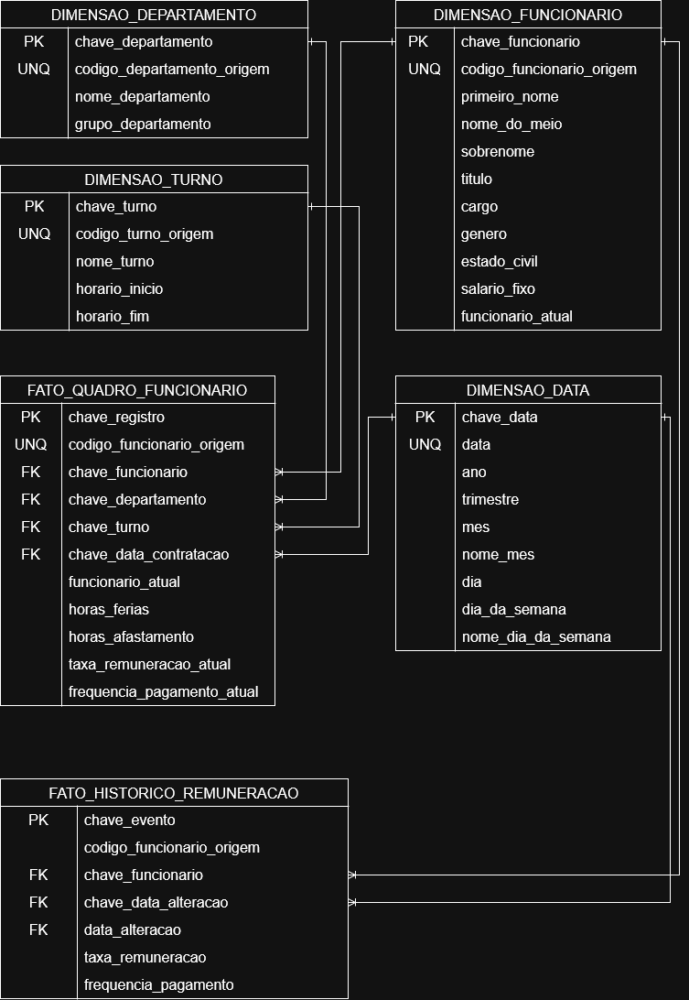
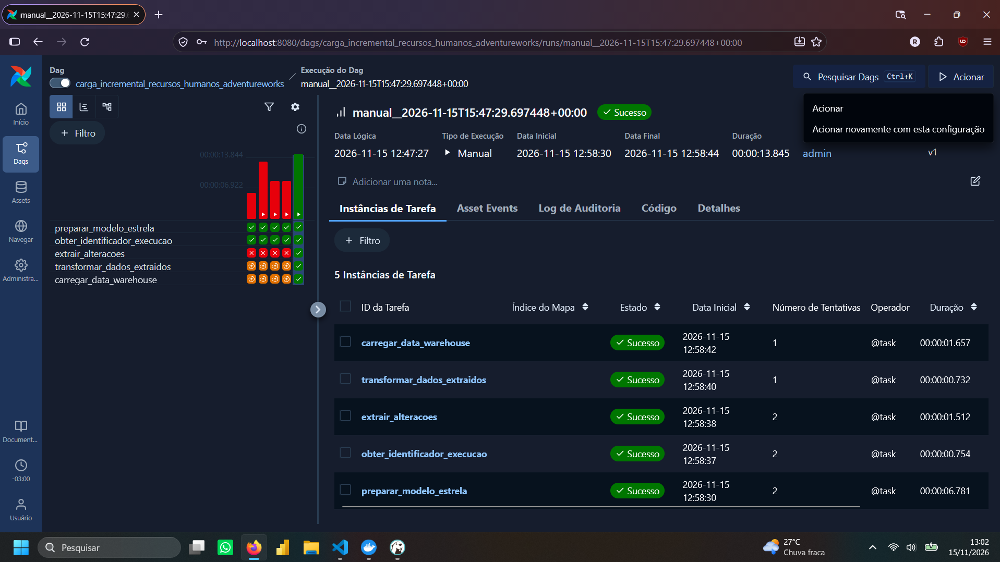

# Construção de um Data Warehouse com ETL incremental e Apache Airflow: indicadores de Recursos Humanos do AdventureWorks

**[Nome do estudante]**
[Curso] — Unisales
[E-mail institucional]

## Resumo

A análise de Recursos Humanos depende de dados consolidados que o modelo transacional do AdventureWorks não entrega diretamente. Este artigo descreve o projeto e a implementação de um Data Warehouse em PostgreSQL, com modelagem multidimensional no padrão Star Schema, para funcionários, departamentos, turnos e histórico de remuneração. Foram definidos dez indicadores e construída uma pipeline ETL incremental orquestrada pelo Apache Airflow, usando o `ModifiedDate` das tabelas de origem como marcador. A carga inicial produziu 290 funcionários, 316 eventos de remuneração, 17 departamentos, 4 turnos e 178 datas; uma segunda execução, sem alterações na origem, processou zero registros. Os resultados mostram 61,7% do quadro na Produção, 71,0% de funcionários do gênero masculino e 60,7% no turno diurno.

**Palavras-chave:** Data Warehouse; Modelagem Dimensional; ETL Incremental; Apache Airflow; Indicadores de Recursos Humanos.

## Abstract

Human Resources analysis depends on consolidated data that the AdventureWorks transactional model does not provide directly. This paper describes a PostgreSQL Data Warehouse using a Star Schema for employees, departments, shifts and pay history. Ten indicators were defined and an incremental ETL pipeline orchestrated by Apache Airflow was built, using `ModifiedDate` as a watermark. The initial load produced 290 employees, 316 pay events and 178 dates; a second run, with no source changes, processed zero records. Results show 61.7% of the workforce in Production, 71.0% male employees and 60.7% on the day shift.

**Keywords:** Data Warehouse; Dimensional Modeling; Incremental ETL; Apache Airflow; Human Resources Indicators.

## 1 Introdução

Sistemas transacionais priorizam integridade e baixa latência no registro de operações, não a resposta a perguntas analíticas que envolvem séries históricas e agregações. Em Recursos Humanos, questões como “quantos funcionários ativos existem por departamento e turno” ou “como a remuneração evoluiu” exigem vários *joins* sobre tabelas normalizadas. A separação entre o ambiente operacional e um repositório analítico, materializada no Data Warehouse (DW), é a resposta consolidada da literatura (INMON, 2005; KIMBALL; ROSS, 2013).

O AdventureWorks é um banco de demonstração da Microsoft cujo OLTP reúne schemas de vendas, produção, compras, pessoas e Recursos Humanos. A amostra `AdventureWorks2025` contém 71 tabelas e 290 funcionários. Apesar do volume reduzido, reproduz dificuldades típicas de um OLTP real: normalização, chaves naturais, tabelas de histórico, dados sensíveis e necessidade de rastrear alterações.

O problema que orienta o trabalho é: como estruturar, carregar e manter, de forma incremental e reproduzível, um Data Warehouse capaz de sustentar indicadores de Recursos Humanos? O objetivo geral é projetar e implementar esse DW em PostgreSQL com modelagem Star Schema e ETL incremental no Apache Airflow. Os objetivos específicos são: avaliar o OLTP e delimitar o recorte; definir dez indicadores; modelar dimensões e fatos com granularidade explícita; implementar a carga incremental e o cálculo em SQL; e registrar o processo em repositório versionado.

A pesquisa é aplicada, de caráter exploratório-descritivo, conduzida como estudo de caso técnico nas etapas de análise, modelagem, implementação, execução controlada e avaliação. O ambiente usa Docker Compose, com SQL Server 2025 como origem, PostgreSQL como destino, Airflow para orquestração e uma instância PostgreSQL separada para os metadados do Airflow. O código está em <https://github.com/ruan-slv/ETL_Competencia>.

## 2 Referencial teórico

### 2.1 Data Warehouse e modelagem multidimensional

Inmon (2005) define o Data Warehouse como um repositório orientado por assunto, integrado, não volátil e variável no tempo. Kimball e Ross (2013) complementam com a modelagem dimensional, que organiza os dados em tabelas fato — medidas em uma granularidade definida — e tabelas dimensão, que descrevem o contexto (quem, o quê, quando, onde e como).

No Star Schema, cada fato referencia diretamente um conjunto reduzido de dimensões desnormalizadas, formando uma estrela. O desenho privilegia legibilidade e desempenho analítico, ao custo de redundância controlada. Dimensões compartilhadas por mais de um fato são conformadas e garantem consistência semântica (KIMBALL; ROSS, 2013). A granularidade é a decisão central, pois determina o nível de detalhe e as perguntas que o modelo responde. Chaves substitutas isolam o DW das chaves naturais, membros padrão evitam nulos em chaves estrangeiras e a dimensão de data pré-calculada simplifica agregações temporais (ELMASRI; NAVATHE, 2019).

### 2.2 ETL e carga incremental

O ETL (Extract, Transform, Load) move e prepara os dados entre ambientes. A carga pode ser completa ou incremental; a segunda processa apenas registros novos ou modificados, reduzindo volume, tempo e concorrência sobre a origem, mas exige um mecanismo confiável de identificação de mudanças (KIMBALL; ROSS, 2013).

Uma estratégia frequente usa marcadores (*watermarks*) baseados em datas de modificação. O processo persiste o maior valor já tratado e extrai registros com `ModifiedDate` estritamente maior. A comparação estrita evita reprocessar indefinidamente linhas empatadas no último instante. A idempotência é obtida com chaves naturais e *upsert* (`ON CONFLICT`), confirmando dados e marcadores na mesma transação. A abordagem não distingue alterações com o mesmo instante máximo nem detecta exclusões físicas; Change Data Capture (CDC), Change Tracking ou reconciliação cobririam esses casos.

### 2.3 Orquestração com Apache Airflow

O Airflow organiza pipelines como grafos acíclicos dirigidos (DAGs), em que tarefas representam etapas e arestas expressam dependências. A ferramenta oferece agendamento, controle de concorrência, repetição de execuções, histórico e interface de acompanhamento (APACHE SOFTWARE FOUNDATION, 2026). Neste projeto, o Airflow agenda e encadeia funções Python de preparação, extração, transformação e carga.

## 3 Desenvolvimento

### 3.1 Análise do modelo OLTP

O AdventureWorks2025 possui 71 tabelas nos schemas `dbo`, `HumanResources`, `Person`, `Production`, `Purchasing` e `Sales`. O recorte analítico usa `HumanResources` e `Person`, que concentram o quadro, a estrutura organizacional e os históricos. O Quadro 1 resume a volumetria.

**Quadro 1 – Volumetria das tabelas analisadas**

| Tabela | Linhas | Papel no domínio |
| --- | ---: | --- |
| `HumanResources.Employee` | 290 | Cadastro, cargo, gênero, estado civil, contratação, situação e saldos de horas |
| `Person.Person` | 19.972 | Cadastro de pessoas; 290 associadas a funcionários |
| `HumanResources.Department` | 16 | Departamentos e grupos |
| `HumanResources.Shift` | 3 | Turnos e horários |
| `HumanResources.EmployeeDepartmentHistory` | 296 | Histórico de alocação em departamento e turno |
| `HumanResources.EmployeePayHistory` | 316 | Histórico de taxa e frequência de pagamento |

*Fonte: elaborado pelo autor (2026), a partir do SQL Server.*

O modelo é normalizado e baseado em chaves naturais. `Employee` compartilha `BusinessEntityID` com `Person.Person`; `EmployeeDepartmentHistory` tem chave composta por funcionário, início, departamento e turno; `EmployeePayHistory` é identificada por funcionário e instante da alteração.

As seis tabelas monitoradas possuem `ModifiedDate`, usada como marcador. Também foram identificados dados não copiados: número nacional de identificação, login, senha, nascimento, dados demográficos, telefone e endereço. De `Person.Person`, aproveitam-se nome, nome do meio, sobrenome e título. A remuneração é tratada como medida restrita.

A amostra limita as análises: todos os 290 funcionários estão ativos, as contratações vão de 2006 a 2013 e não há desligamentos; assim, não se calcula rotatividade, e os resultados descrevem o banco de demonstração.

### 3.2 Modelo multidimensional e granularidade

O modelo tem duas tabelas fato que compartilham dimensões conformadas, formando dois esquemas estrela relacionados (Figura 1).

As granularidades são explícitas:

- **`fato_quadro_funcionario`**: uma linha por funcionário e seu estado mais recente, com departamento e turno da atribuição aberta mais recente, data de contratação, saldos de horas e última taxa.
- **`fato_historico_remuneracao`**: uma linha por funcionário e instante de alteração da taxa; a combinação funcionário + `data_alteracao` é única.

As dimensões são `dimensao_funcionario` (código de origem, nome, cargo, gênero, estado civil, tipo de remuneração e situação), `dimensao_departamento` (código, nome e grupo), `dimensao_turno` (código, nome e horários) e `dimensao_data` (chave `AAAAMMDD`, data, ano, trimestre, mês, dia e dia da semana), reutilizada para contratação e alteração salarial.

A desnormalização de funcionário e pessoa reduz *joins*. Chaves substitutas isolam o DW das chaves naturais, que permanecem para rastreabilidade. Dimensões conformadas permitem comparar os fatos no mesmo contexto. Membros padrão (chave zero) representam “não informado” em departamento e turno. A dimensão de data numérica dispensa extrações em tempo de consulta. Optou-se por não historizar dimensões (Tipo 2): o foco são dez indicadores sobre o estado atual e o histórico de remuneração, e a dimensão guarda o estado mais recente — escolha registrada como limitação.

**Figura 1 – Modelo estrela do Data Warehouse de Recursos Humanos**



*Fonte: elaborado pelo autor (2026).*

### 3.3 Dicionário de dados

O Quadro 2 sintetiza o dicionário do schema `modelo_estrela`; a versão completa está em `docs/DICIONARIO_DADOS.md`.

**Quadro 2 – Dicionário resumido do modelo multidimensional**

| Tabela | Campos e tipos | Chaves e significado |
| --- | --- | --- |
| `dimensao_funcionario` | `chave_funcionario` BIGINT; `codigo_funcionario_origem` INTEGER UNQ; nomes e `cargo` VARCHAR(100); `titulo` VARCHAR(20); `genero` e `estado_civil` CHAR(1); dois indicadores BOOLEAN | PK; reúne atributos de `Employee` e `Person.Person`. |
| `dimensao_departamento` | `chave_departamento` BIGINT; código INTEGER UNQ; `nome_departamento` e `grupo_departamento` VARCHAR(100) | PK; chave zero = “Não informado”. |
| `dimensao_turno` | `chave_turno` BIGINT; código INTEGER UNQ; `nome_turno` VARCHAR(100); `horario_inicio` e `horario_fim` TIME | PK; chave zero = “Não informado”. |
| `dimensao_data` | `chave_data` INTEGER; `data` DATE; `ano`, `trimestre`, `mes`, `dia` e `dia_da_semana` SMALLINT; nomes VARCHAR(20) | PK `AAAAMMDD`; UNQ `data`. Calendário de contratação e alteração. |
| `fato_quadro_funcionario` | `chave_registro` BIGINT; código INTEGER UNQ; FKs para as quatro dimensões; situação BOOLEAN; horas SMALLINT; taxa NUMERIC(19,4); frequência SMALLINT | PK; uma linha por funcionário. |
| `fato_historico_remuneracao` | `chave_evento` BIGINT; código INTEGER; FKs para funcionário e data; `data_alteracao` TIMESTAMP; taxa NUMERIC(19,4); frequência SMALLINT | PK; UNQ (código, `data_alteracao`). Uma linha por alteração. |
| `controle_incremental_recursos_humanos` | `tabela_origem` VARCHAR(100); `ultima_modificacao` TIMESTAMP; `atualizado_em` TIMESTAMPTZ | PK; marcador por tabela monitorada. |

*Fonte: elaborado pelo autor (2026).*

### 3.4 Indicadores

O Quadro 3 apresenta os dez indicadores e a lógica implementada em SQL.

**Quadro 3 – Indicadores definidos para o domínio de Recursos Humanos**

| # | Indicador | Lógica de cálculo |
| ---: | --- | --- |
| 1 | Funcionários ativos | Contagem de linhas com `funcionario_atual` verdadeiro. |
| 2 | Funcionários por departamento | Contagem por departamento da atribuição aberta mais recente. |
| 3 | Funcionários por cargo | Contagem por `cargo`. |
| 4 | Distribuição por gênero | Contagem e percentual do quadro por gênero, com função de janela. |
| 5 | Contratações por ano | Contagem agrupada pelo ano da contratação. |
| 6 | Tempo médio de empresa | Média de anos e fração de meses entre contratação e data atual. |
| 7 | Taxa média de remuneração | Última taxa por funcionário (`DISTINCT ON`), por departamento e frequência. |
| 8 | Variação da remuneração | `LAG` sobre as taxas; compara apenas frequências iguais. |
| 9 | Horas de férias e afastamento | Médias dos dois campos por departamento. |
| 10 | Funcionários por turno | Contagem por nome e horário do turno. |

*Fonte: elaborado pelo autor (2026).*

Os indicadores 7 e 8 preservam a frequência de pagamento da origem, sem conversão para salário mensal ou anual, evitando comparações inválidas. O indicador 9 descreve saldos cadastrados, não horas efetivamente utilizadas.

### 3.5 Estratégia de ETL incremental

A tabela `controle_incremental_recursos_humanos` mantém um marcador para cada uma das seis tabelas observadas. Em cada execução, o processo lê os marcadores, consulta o maior `ModifiedDate` da origem (fotografia) e extrai registros com `ModifiedDate` maior que o marcador anterior e menor ou igual à fotografia. A primeira carga é completa; as seguintes tratam apenas os registros afetados.

Dimensões e fatos usam `ON CONFLICT` sobre a chave natural, atualizando em vez de duplicar. Dados e marcadores são gravados na mesma transação PostgreSQL: uma falha reverte ambos, e repetir a carga é idempotente. Na validação, a primeira execução processou 16 departamentos, 3 turnos, 290 funcionários e 316 registros de remuneração; a segunda, sem alterações, retornou zero em todas as categorias. Permanecem as limitações de alterações empatadas no mesmo `ModifiedDate` e de exclusões físicas.

### 3.6 Pipeline no Apache Airflow

A DAG `carga_incremental_recursos_humanos_adventureworks` é agendada diariamente (`@daily`), com `catchup=False` e `max_active_runs=1`, evitando execuções concorrentes. O Quadro 4 descreve as cinco tarefas encadeadas.

**Quadro 4 – Tarefas e dependências da DAG**

| Ordem | Tarefa | Responsabilidade |
| ---: | --- | --- |
| 1 | `preparar_modelo_estrela` | Cria schema, dimensões, fatos, índices e controle; pode ser repetida sem apagar dados. |
| 2 | `obter_identificador_execucao` | Obtém o `run_id` para separar arquivos temporários. |
| 3 | `extrair_alteracoes` | Lê marcadores, consulta a fotografia e extrai registros alterados para JSON. |
| 4 | `transformar_dados_extraidos` | Valida códigos, datas, horários, decimais e booleanos. |
| 5 | `carregar_data_warehouse` | Atualiza dimensões e fatos e grava marcadores na mesma transação. |

*Fonte: elaborado pelo autor (2026).*

As dependências são sequenciais: preparação → identificação → extração → transformação → carga. Apenas caminhos de arquivo trafegam pelo XCom; os registros ficam em JSON local. A Figura 2 registra uma execução manual concluída em 15/11/2026, das 12h58min30s às 12h58min44s (13,845 segundos), com as cinco tarefas no estado *success*.

**Figura 2 – Execução da DAG no Apache Airflow**



*Fonte: captura de tela do autor (2026).*

A carga valida se a quantidade de linhas gravadas corresponde à extraída, interrompendo a execução em caso de divergência.

### 3.7 Implementação SQL dos indicadores

Os dez indicadores estão em `src/sql/indicadores.sql`. O repositório organiza as DAGs em `dags/`, os scripts SQL em `src/sql/`, a carga em `src/etl/` e a documentação em `docs/`. O trecho a seguir apresenta o indicador 8, com funções de janela.

```sql
WITH variacoes AS (
  SELECT codigo_funcionario_origem, frequencia_pagamento, data_alteracao,
         taxa_remuneracao,
         LAG(frequencia_pagamento) OVER (PARTITION BY codigo_funcionario_origem
             ORDER BY data_alteracao) AS frequencia_anterior,
         LAG(taxa_remuneracao) OVER (PARTITION BY codigo_funcionario_origem
             ORDER BY data_alteracao) AS taxa_anterior
  FROM modelo_estrela.fato_historico_remuneracao
)
SELECT frequencia_pagamento, COUNT(*) AS quantidade_de_alteracoes_comparaveis,
       AVG(taxa_remuneracao - taxa_anterior) AS variacao_media_da_taxa,
       100.0 * SUM(taxa_remuneracao - taxa_anterior)
           / NULLIF(SUM(taxa_anterior), 0) AS variacao_percentual_acumulada
FROM variacoes
WHERE frequencia_pagamento = frequencia_anterior
GROUP BY frequencia_pagamento
ORDER BY frequencia_pagamento;
```

`LAG` recupera a taxa anterior do mesmo funcionário e a frequência associada. O filtro exclui comparações entre frequências distintas, e `NULLIF` evita divisão por zero. As demais consultas usam agregações, junções com dimensões e funções de janela apenas quando necessário.

### 3.8 Resultados

Após a carga, o DW continha 290 funcionários, 316 registros de remuneração, 17 departamentos (16 da origem e o membro “Não informado”), 4 turnos e 178 datas. O Quadro 5 apresenta os resultados.

**Quadro 5 – Resultados dos indicadores**

| # | Indicador | Resultado observado |
| ---: | --- | --- |
| 1 | Funcionários ativos | 290 |
| 2 | Funcionários por departamento | Production: 179; Sales: 18; Purchasing: 12; demais completam 81 |
| 3 | Funcionários por cargo | 67 cargos; Production Technician WC40, WC50 e WC60, com 26 cada |
| 4 | Distribuição por gênero | Masculino: 206 (71,03%); feminino: 84 (28,97%) |
| 5 | Contratações por ano | 2006: 1; 2007: 6; 2008: 74; 2009: 148; 2010: 38; 2011: 16; 2012: 4; 2013: 3 |
| 6 | Tempo médio de empresa | 17,41 anos |
| 7 | Taxa média de remuneração | Frequência 1: 12,12; frequência 2: 26,09 |
| 8 | Variação da remuneração | Frequência 1: 16 comparações, média 1,4844 e 21,59% acumulada; frequência 2: 10 comparações, média 8,3282 e 36,66% |
| 9 | Horas registradas | 50,61 horas de férias e 45,31 horas de afastamento |
| 10 | Funcionários por turno | Day: 176 (07:00–15:00); Evening: 62 (15:00–23:00); Night: 52 (23:00–07:00) |

*Fonte: elaborado pelo autor (2026), a partir do PostgreSQL.*

Os resultados mostram concentração na Produção (61,7%) e no turno diurno (60,7%). O pico de 2009 (148 contratações, 51,0% do total) explica o tempo médio de empresa de 17,41 anos. A distribuição por gênero é assimétrica (71,0% masculino), o que pode orientar análises de diversidade, embora o indicador não meça equidade salarial.

No indicador 8, a frequência 2 teve maior variação média absoluta, enquanto a frequência 1 apresentou 21,59% de variação acumulada. Os saldos médios de 50,61 e 45,31 horas descrevem o cadastro, não o uso efetivo. A segunda execução processou zero registros, e os quatro testes unitários passaram, confirmando o comportamento incremental.

## 4 Considerações finais

O trabalho projetou e implementou um Data Warehouse de Recursos Humanos a partir do AdventureWorks, com Star Schema, ETL incremental e orquestração no Apache Airflow. Os objetivos foram alcançados: o OLTP foi avaliado, dez indicadores foram definidos e calculados, o modelo físico foi criado no PostgreSQL e a pipeline executou com sucesso, inclusive a prova de que uma segunda carga sem mudanças não reprocessa dados.

A principal contribuição é a integração entre modelagem dimensional, controle incremental por `ModifiedDate` e orquestração declarativa, demonstrando que é possível manter o DW atualizado com baixo custo de processamento e rastreabilidade.

As limitações decorrem da amostra — todos ativos, sem desligamentos e com datas entre 2006 e 2013 — e do ponto de vista técnico: o marcador não cobre alterações empatadas nem exclusões, e as dimensões não são historizadas. Trabalhos futuros podem incorporar CDC ou Change Tracking, dimensões Tipo 2, testes de qualidade, alertas de falha e uma camada de apresentação.

## Referências

APACHE SOFTWARE FOUNDATION. **Apache Airflow Documentation**. Disponível em: <https://airflow.apache.org/docs/>. Acesso em: 15 nov. 2026.

ELMASRI, Ramez; NAVATHE, Shamkant B. **Sistemas de banco de dados**. 7. ed. São Paulo: Pearson, 2019.

INMON, William H. **Building the Data Warehouse**. 4. ed. Indianapolis: Wiley, 2005.

KIMBALL, Ralph; ROSS, Margy. **The Data Warehouse Toolkit**: the definitive guide to dimensional modeling. 3. ed. Indianapolis: Wiley, 2013.

MICROSOFT. **AdventureWorks sample databases**. Disponível em: <https://learn.microsoft.com/sql/samples/adventureworks-install-configure>. Acesso em: 15 nov. 2026.
