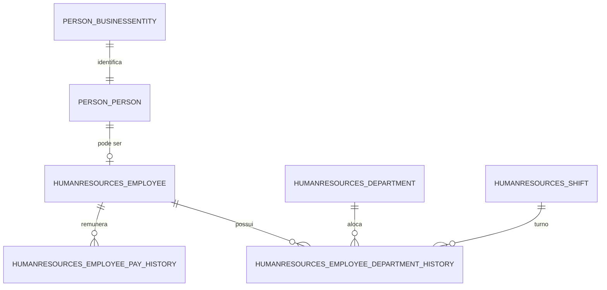

# Análise do modelo OLTP AdventureWorks

Este documento avalia o modelo de dados original (OLTP) do banco
`AdventureWorks2025`, utilizado como origem do Data Warehouse do projeto. A
análise complementa [`ETL_INCREMENTAL.md`](./ETL_INCREMENTAL.md),
[`DICIONARIO_DADOS.md`](./DICIONARIO_DADOS.md) e
[`modelo_estrela.mmd`](./modelo_estrela.mmd).

Os números apresentados foram consultados diretamente no SQL Server em
**31/10/2026**, após a restauração do backup `AdventureWorks2025.bak`.

## 1. Objetivo e escopo

O AdventureWorks é um banco de demonstração da Microsoft com características de
um sistema transacional: dados normalizados, entidades separadas, chaves
naturais, tabelas de histórico e atributos operacionais. O objetivo desta
avaliação é identificar:

- quais tabelas e relacionamentos sustentam o domínio de Recursos Humanos;
- quais características do OLTP dificultam consultas analíticas;
- quais dados podem ser usados com segurança no Data Warehouse;
- quais decisões de modelagem multidimensional são necessárias.

O recorte analítico utiliza os schemas `HumanResources` e `Person`, com foco no
quadro de funcionários, departamentos, turnos e histórico de remuneração.

## 2. Visão geral do banco

O banco possui 71 tabelas de usuário distribuídas nos seguintes schemas:

| Schema | Tabelas | Papel predominante |
| --- | ---: | --- |
| `dbo` | 3 | Objetos auxiliares e de infraestrutura. |
| `HumanResources` | 6 | Funcionários, departamentos, turnos e históricos. |
| `Person` | 13 | Pessoas, endereços, contatos e dados demográficos. |
| `Production` | 25 | Produtos, listas de materiais, estoque e produção. |
| `Purchasing` | 5 | Fornecedores, ordens de compra e recebimentos. |
| `Sales` | 19 | Clientes, pedidos, vendedores e territórios. |

O schema `HumanResources` concentra o domínio analisado. O schema `Person` é
usado apenas para obter nome, nome do meio, sobrenome e título da pessoa
associada ao funcionário.

## 3. Tabelas analisadas

| Tabela | Linhas | Papel no domínio |
| --- | ---: | --- |
| `HumanResources.Employee` | 290 | Cadastro do funcionário, cargo, gênero, estado civil, data de contratação, situação atual e saldos de horas. |
| `Person.Person` | 19.972 | Cadastro geral de pessoas; apenas 290 estão associadas a funcionários. |
| `HumanResources.Department` | 16 | Departamentos e grupos organizacionais. |
| `HumanResources.Shift` | 3 | Turnos de trabalho e horários. |
| `HumanResources.EmployeeDepartmentHistory` | 296 | Histórico de alocação do funcionário em departamento e turno. |
| `HumanResources.EmployeePayHistory` | 316 | Histórico de taxa de remuneração e frequência de pagamento. |

A tabela `Person.BusinessEntity` é a entidade base de identificação das pessoas.
`Person.Person` compartilha a chave `BusinessEntityID` com ela e é referenciada
por `HumanResources.Employee`.

## 4. Chaves e relacionamentos

As principais chaves e relacionamentos são:

- `HumanResources.Employee.BusinessEntityID` é chave primária e chave
  estrangeira para `Person.Person.BusinessEntityID`.
- `Person.Person.BusinessEntityID` é chave primária e chave estrangeira para
  `Person.BusinessEntity.BusinessEntityID`.
- `HumanResources.Department.DepartmentID` é chave primária.
- `HumanResources.Shift.ShiftID` é chave primária.
- `HumanResources.EmployeeDepartmentHistory` tem chave primária composta por
  `BusinessEntityID`, `StartDate`, `DepartmentID` e `ShiftID`, com chaves
  estrangeiras para funcionário, departamento e turno.
- `HumanResources.EmployeePayHistory` tem chave primária composta por
  `BusinessEntityID` e `RateChangeDate`, com chave estrangeira para funcionário.

O relacionamento entre pessoa e funcionário é opcional: uma pessoa pode existir
sem cadastro de funcionário. Nesta amostra, todos os 290 funcionários possuem
registro correspondente em `Person.Person`, e não há pessoa classificada como
funcionário ou vendedor sem registro em `HumanResources.Employee`.

## 5. Características do modelo OLTP

### 5.1 Normalização e separação de entidades

O modelo é organizado para operações transacionais. Os dados cadastrais,
históricos, departamentos e turnos ficam em tabelas separadas, relacionadas por
chaves. Isso reduz redundância e protege a consistência das operações, mas exige
vários joins para responder perguntas analíticas simples, como “quantos
funcionários ativos existem por departamento e turno”.

### 5.2 Chaves naturais e históricos

As chaves são baseadas nos identificadores de negócio (`BusinessEntityID`,
`DepartmentID`, `ShiftID`). O histórico de departamento e o histórico de
remuneração usam chaves compostas e datas de início ou alteração. No Data
Warehouse, essas chaves naturais são preservadas para rastreabilidade, mas as
tabelas dimensionais recebem chaves substitutas.

### 5.3 Estado atual e histórico

`HumanResources.Employee` mantém o estado atual do funcionário, incluindo
`CurrentFlag`, `VacationHours` e `SickLeaveHours`. Já
`EmployeeDepartmentHistory` e `EmployeePayHistory` preservam eventos
históricos. Essa separação é adequada para o OLTP, mas exige decisões
explícitas de granularidade no modelo dimensional:

- uma linha por funcionário para o quadro atual;
- uma linha por funcionário e instante de alteração para o histórico de
  remuneração.

### 5.4 Rastreamento de alterações

As seis tabelas observadas possuem a coluna `ModifiedDate`. Ela é usada como
marcador de extração incremental. A estratégia e suas limitações estão descritas
em [`ETL_INCREMENTAL.md`](./ETL_INCREMENTAL.md).

### 5.5 Tipos de dados e atributos sensíveis

O OLTP utiliza tipos como `money` para remuneração, `bit` para indicadores,
`tinyint` para frequência de pagamento e turno, `nchar` para códigos e
`datetime` para datas de modificação. A carga para PostgreSQL converte esses
valores para tipos equivalentes, preservando o significado dos códigos.

`Person.Person` contém dados pessoais e campos que não são necessários ao
projeto, como `Demographics`, `AdditionalContactInfo`, `EmailPromotion` e
`rowguid`. `HumanResources.Employee` contém `NationalIDNumber`, `LoginID` e
`BirthDate`, que também não são extraídos. O fluxo usa apenas nome, nome do
meio, sobrenome e título da pessoa, além dos atributos funcionais necessários
aos indicadores.

## 6. Volumetria e distribuição observadas

### 6.1 Funcionários

| Métrica | Valor |
| --- | ---: |
| Total de funcionários | 290 |
| Funcionários com `CurrentFlag = 1` | 290 |
| Funcionários com `CurrentFlag = 0` | 0 |
| Data de contratação mínima | 30/06/2006 |
| Data de contratação máxima | 30/05/2013 |
| Cargos distintos (`JobTitle`) | 67 |
| Gênero masculino | 206 |
| Gênero feminino | 84 |
| Estado civil casado | 146 |
| Estado civil solteiro | 144 |
| Funcionários assalariados (`SalariedFlag = 1`) | 52 |

Todos os funcionários da amostra estão marcados como atuais. Isso significa que
a base não permite calcular rotatividade, demissões ou variação líquida de
quadro ao longo do tempo.

### 6.2 Departamentos e turnos

| Item | Valor |
| --- | ---: |
| Departamentos | 16 |
| Grupos de departamento distintos | 6 |
| Turnos | 3 |

Os turnos são:

| Turno | Início | Fim |
| --- | --- | --- |
| Day | 07:00 | 15:00 |
| Evening | 15:00 | 23:00 |
| Night | 23:00 | 07:00 |

### 6.3 Histórico de departamento

| Métrica | Valor |
| --- | ---: |
| Registros de histórico | 296 |
| Funcionários distintos | 290 |
| Atribuições abertas (`EndDate` nulo) | 290 |
| Atribuições encerradas | 6 |
| Início mínimo | 30/06/2006 |
| Início máximo | 14/11/2013 |

Cada funcionário possui uma atribuição aberta. As seis atribuições encerradas
representam movimentações históricas. O Data Warehouse usa a atribuição aberta
mais recente para compor o quadro atual.

### 6.4 Histórico de remuneração

| Métrica | Valor |
| --- | ---: |
| Registros de remuneração | 316 |
| Funcionários distintos | 290 |
| Registros com frequência de pagamento 1 | 180 |
| Registros com frequência de pagamento 2 | 136 |
| Data mínima de alteração | 30/06/2006 |
| Data máxima de alteração | 14/07/2013 |
| Taxa mínima | 6,5000 |
| Taxa máxima | 125,5000 |

Há 26 registros adicionais além do primeiro registro de cada funcionário. Esses
registros adicionais alimentam o indicador de variação entre taxas consecutivas.
Os códigos de frequência de pagamento são preservados como na origem; não há
conversão para salário mensal ou anual.

### 6.5 Pessoas

| Métrica | Valor |
| --- | ---: |
| Pessoas cadastradas | 19.972 |
| Funcionários associados | 290 |
| Pessoas com `PersonType = 'EM'` entre os funcionários | 273 |
| Pessoas com `PersonType = 'SP'` entre os funcionários | 17 |
| Funcionários sem registro em `Person.Person` | 0 |

A tabela `Person.Person` contém clientes, fornecedores, contatos e outros tipos
de pessoa. Por isso, qualquer consulta analítica precisa restringir o conjunto
aos identificadores presentes em `HumanResources.Employee`.

## 7. Qualidade, limitações e privacidade

- **Amostra estática:** todos os 290 funcionários estão ativos e as datas vão de
  2006 a 2013. Os indicadores descrevem o banco de demonstração, não uma empresa
  real em 2026.
- **Ausência de desligamentos:** não há funcionários com `CurrentFlag = 0`, o que
  impede o cálculo de rotatividade e de variação de quadro.
- **Histórico de remuneração sem anualização:** as taxas são mantidas na
  frequência original. Frequências diferentes não devem ser somadas nem
  comparadas diretamente.
- **Saldos de horas:** `VacationHours` e `SickLeaveHours` são saldos cadastrados,
  não registros de horas efetivamente utilizadas.
- **Marcador por `ModifiedDate`:** a extração incremental usa o maior
  `ModifiedDate` por tabela. Alterações com o mesmo instante do marcador e
  exclusões físicas podem não ser detectadas; a limitação está documentada em
  [`ETL_INCREMENTAL.md`](./ETL_INCREMENTAL.md).
- **Dados pessoais:** o fluxo evita identificar números nacionais, login, data de
  nascimento, dados demográficos e informações de contato. O acesso ao Data
  Warehouse deve ser restrito por conter taxas de remuneração.
- **Hierarquia organizacional:** `OrganizationNode` e `OrganizationLevel` não
  foram modelados. Eles poderiam originar uma dimensão hierárquica futura, mas
  não são necessários para os dez indicadores atuais.

## 8. Implicações para o modelo multidimensional

A avaliação do OLTP justifica as seguintes decisões do modelo estrela:

1. **Desnormalização controlada:** os atributos de funcionário e pessoa são
   reunidos em `dimensao_funcionario`, reduzindo joins nas consultas analíticas.
2. **Chaves substitutas:** cada dimensão recebe uma chave própria; as chaves
   naturais permanecem para rastreabilidade.
3. **Dimensões compartilhadas:** `dimensao_funcionario`, `dimensao_departamento`,
   `dimensao_turno` e `dimensao_data` atendem aos dois fatos relacionados.
4. **Granularidade explícita:** `fato_quadro_funcionario` representa o estado
   atual por funcionário; `fato_historico_remuneracao` representa uma alteração
   de taxa por funcionário e instante.
5. **Membros padrão:** departamento e turno não informados usam a chave zero,
   evitando valores nulos nas chaves estrangeiras dos fatos.
6. **Carga incremental:** o `ModifiedDate` das tabelas de origem alimenta a
   tabela de controle e permite processar apenas registros novos ou alterados.
7. **Minimização de dados pessoais:** somente os atributos necessários aos
   indicadores são copiados para o Data Warehouse.

O modelo resultante, o dicionário de dados e as consultas dos indicadores estão
em [`modelo_estrela.mmd`](./modelo_estrela.mmd),
[`DICIONARIO_DADOS.md`](./DICIONARIO_DADOS.md) e
[`../src/sql/indicadores.sql`](../src/sql/indicadores.sql).

## 9. Conclusão

O AdventureWorks2025 é um OLTP normalizado, orientado a operações e com
históricos separados. O recorte de `HumanResources` e `Person` contém dados
suficientes para construir um Data Warehouse de Recursos Humanos com dez
indicadores, mas exige tratamento explícito de granularidade, chaves
substitutas, histórico, privacidade e carga incremental.

A amostra de 290 funcionários, 16 departamentos, 3 turnos, 296 registros de
histórico de departamento e 316 registros de remuneração foi validada no
PostgreSQL. As limitações da amostra estão registradas em
[`RESULTADOS_KPIS.md`](./RESULTADOS_KPIS.md) e o andamento do trabalho em
[`STATUS_TRABALHO.md`](./STATUS_TRABALHO.md).
